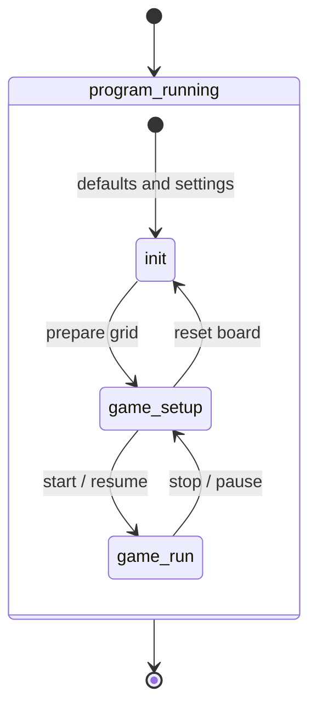
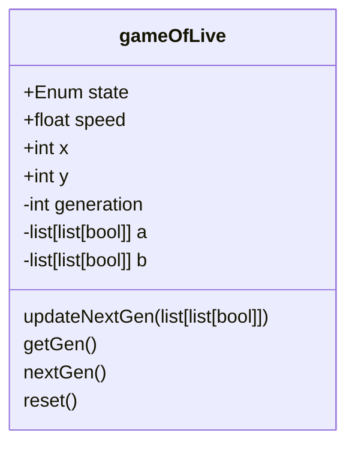

# Conways Game Of Life
A project for implementing Conways Game Of Life with python3.

# Goal
Implementing the game with python >3.12 within a budget of 20h-40h.
AI is not used in creating this project.

## Mandatory
* playing field will be a 100x100 cell grid, min. resolution will prob. be 500x500 pixel
* controls:
  * buttons for starting, pausing, and resetting the game state
  * button for creating a valid starting state (in which the 2nd generation won't all die immediately)
  * in the initial state (before start and after reset), it is possible to manually toggle a cells alive state by clicking on it
  * a "combo" slider to set the game speed between 0.25 and 2 seconds with an input field
## Optional
If there is time left:
* save and load game states
* seeded starts

# How to use
tbd

# Dev Process
## Libraries
Research showed that there are serveral possibilities to draw a grid with python.
Most promissing are tkinter and pygame. They allow interactions with the cells that
might come in handy when setting up the game. I don't think I need "game features", because the game
of live is based on a state machine, so I'll go with tkinter first.

Tkinter supports:
* UI Grouping
* Canvas for drawing a scalable grid
* Control elements (buttons, sliders)

Docs for tkinter: 
* https://docs.python.org/3/library/tkinter.html
* https://tkdocs.com/shipman/
* https://tkdocs.com/tutorial/index.html

## States and data
Game of Life consists of several states in this version:
* init: started program with settings
* game_setup: cleared and created the grid with the active settings (can be manipulated)
* game_run: runs iterations, disables interaction on the grid

### Transistions


### Data
I want to start with the simple thing of two two-dimensional arrays (100x100) containing booleans, which are switched forth and back 
depending on the current iteration. Even iterations use array a as active and array b as the future iteration. This is swapped for uneven iterations. Iterations reset to -1 and start with 0.

If that is not working out, I want to switch to two one-dimensional arrays, each containing ten 100 bit long variables.
Individual bits are then retrieved by bitshifting the required position to the right and set by bitshifting to the left.

Each position that is true / 1, marks the cell as active, false / 0 as inactive.

x and y represent the grid size.



# Setup
```bash
# on Ubuntu 24.04 LTS, tkinter is not included in python3
sudo apt update
sudo apt install python3 python3-tk
```